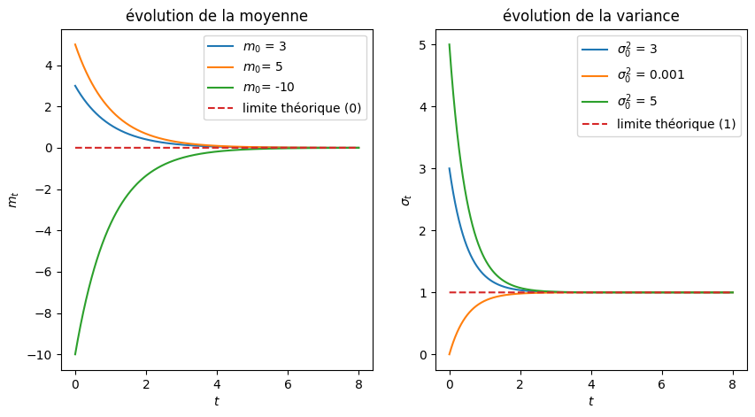
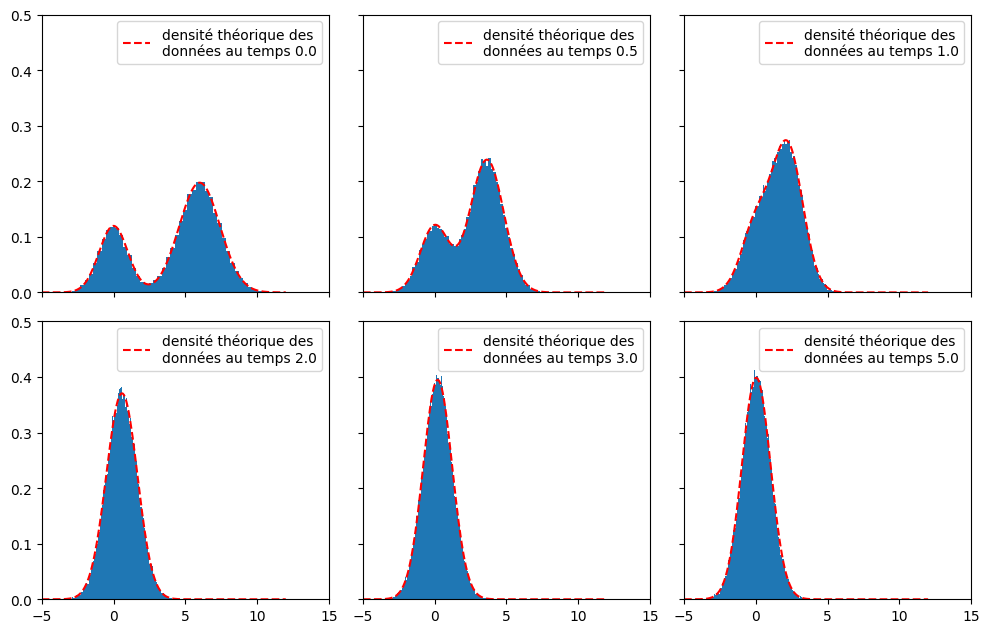
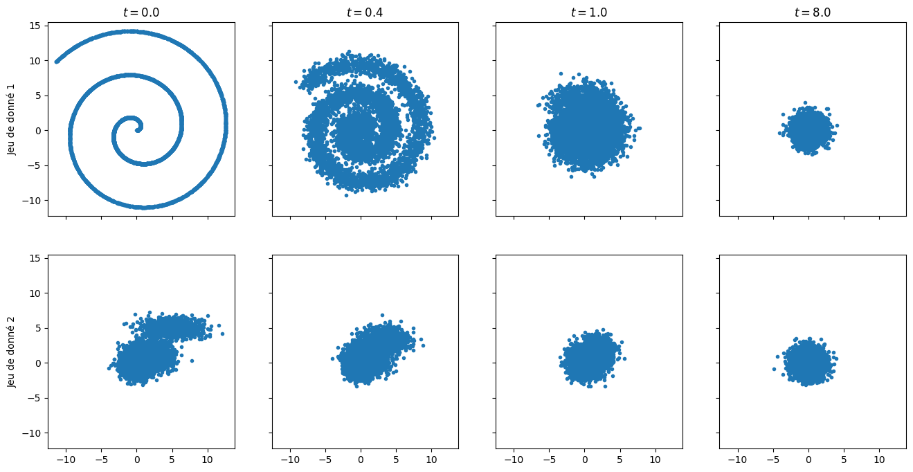
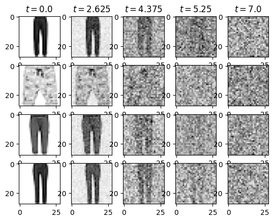
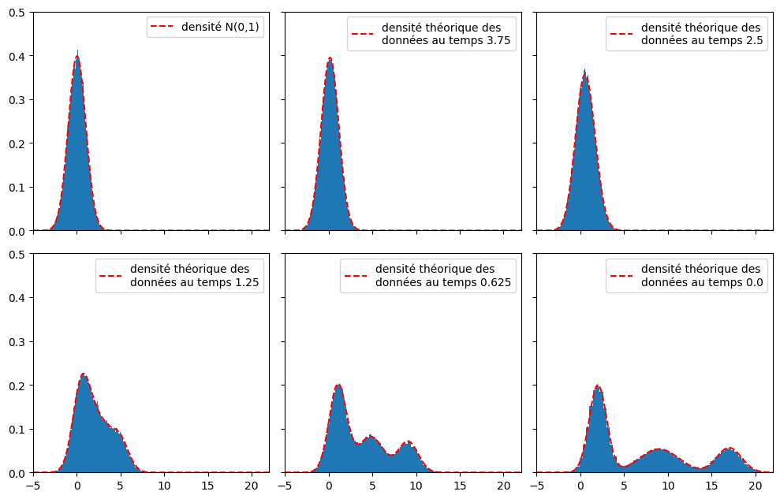
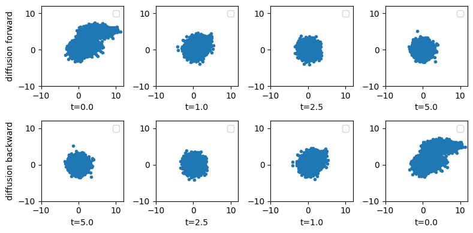
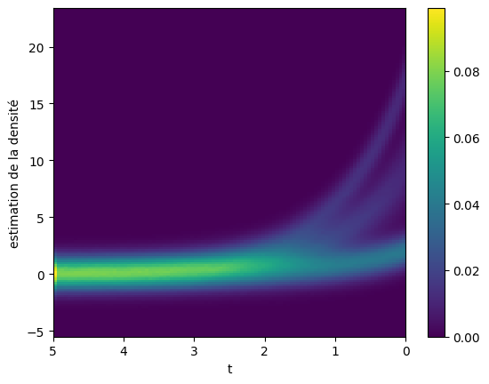
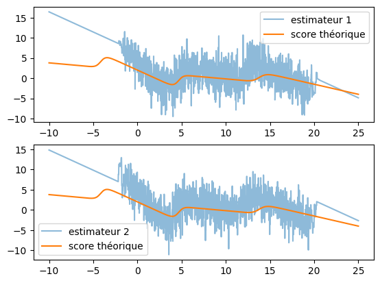
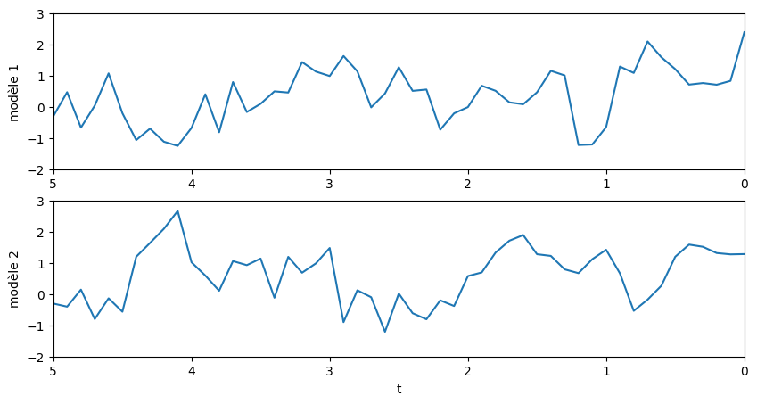

# Score-Based Generative Diffusion Models from Scratch: Stochastic Dynamics, Fokker-Planck & Generalization vs. Memorization

[](https://www.python.org/)
[](https://numpy.org/)
[](https://scipy.org/)
[](https://scikit-learn.org/)
[](https://www.univ-lyon1.fr/)

> **A first-principles mathematical and numerical investigation into Score-Based Generative Modeling—deriving forward Ornstein-Uhlenbeck SDEs, Fokker-Planck density evolution, and reverse-time dynamics without deep learning black boxes or LLM code generation.**

---

## Executive Summary & Motivation

Modern generative AI systems (such as Stable Diffusion and DALL-E) rely on **score-based diffusion models** to synthesize complex data distributions from pure Gaussian noise. However, high-dimensional image spaces often obscure the underlying stochastic mechanics and raise a critical statistical question:

> **Core Research Question:** *Do diffusion models genuinely generalize by learning the underlying score field $\nabla_x \log p_t(x)$ of a data distribution, or do they collapse into memorizing training samples when capacity or sample size is constrained?*

Conducted as a Supervised Research Project (*TER — Travail d'Étude et de Recherche*) during my Master 1 in **Applied Mathematics & Statistics** at **Université Claude Bernard Lyon 1** (supervised by Prof. M. Espinasse, co-authored with Amine Adib), this project builds the entire theoretical and numerical pipeline **from scratch in Python** (`NumPy`, `SciPy`, `Scikit-learn`), deliberately avoiding high-level deep learning frameworks (`PyTorch`/`TensorFlow`) to validate every mathematical derivation numerically.

---

## Key Technical Highlights

* **Stochastic Differential Equations (SDEs) & PDE Analysis:** Derived analytical solutions for the forward **Ornstein-Uhlenbeck (OU)** process and its associated **Fokker-Planck partial differential equation**, proving exponential convergence of arbitrary initial distributions toward $\mathcal{N}(0, I_d)$.
* **Reverse-Time Generative Dynamics:** Formulated the time-reversed Fokker-Planck equation and parameterized the backward drift velocity $v_t(x, h_t) = x + (1 + \alpha) \nabla_x \log h_t(x)$, unifying stochastic reverse SDEs ($\alpha > 0$) and deterministic **Probability Flow ODEs** ($\alpha = 0$).
* **Multi-Regime Numerical Validation (1D, 2D & 784D):** Implemented Euler-Maruyama SDE solvers from scratch and validated marginal distributions and empirical covariance convergence across multimodal Gaussian Mixture Models (GMMs), non-linear 2D manifolds (Archimedean spirals), and high-dimensional **Fashion-MNIST** ($28 \times 28$) images.
* **Non-Parametric Score Estimation & Memorization Audit:** Built a k-Nearest Neighbors ($k$-NN) reverse-drift estimator to approximate unknown score fields and designed a deterministic trajectory-divergence experiment proving how finite-sample non-parametric estimators exhibit variance inflation and sample memorization compared to analytical score fields.

---

## Mathematical Framework

### 1. Forward Diffusion: Ornstein-Uhlenbeck Process
To progressively transform a structured data distribution $X_0 \sim p_0$ into isotropic Gaussian noise, we model particle trajectories via the mean-reverting Ornstein-Uhlenbeck SDE:

$$dX_t = -X_t \, dt + \sqrt{2} \, dW_t$$

At the macroscopic density level, the probability density $f_t(x)$ evolves according to the **Fokker-Planck equation** (combining deterministic transport and heat diffusion):

$$\partial_t f_t(x) = \partial_x (x f_t(x)) + \partial_x^2 f_t(x)$$

Solving this PDE analytically for a Gaussian initial state $\mathcal{N}(m_0, \sigma_0^2)$ yields closed-form parameter dynamics:

$$m_t = m_0 e^{-t} \xrightarrow{t \to \infty} 0, \qquad \sigma_t^2 = 1 + (\sigma_0^2 - 1)e^{-2t} \xrightarrow{t \to \infty} 1$$

<p align="center">
  
  <br>
  <em>Figure 1: Exponential convergence of mean $m_t \to 0$ and variance $\sigma_t^2 \to 1$ across diverse initial conditions.</em>
</p>

### 2. Reverse-Time Diffusion & The Score Function
Defining the time-reversed density $h_t = f_{T-t}$ over $t \in [0, T]$, we derive the reverse-time Fokker-Planck equation parameterized by noise level $\alpha \ge 0$:

$$\partial_t h_t = -\partial_x \Big( \big[x + (1 + \alpha) \nabla_x \log h_t(x)\big] h_t \Big) + \alpha \partial_x^2 h_t$$

The vector field $S(x, t) = \nabla_x \log h_t(x)$ is the **Stein score function**—pointing toward regions of higher data density at noise scale $t$. Setting $\alpha = 0$ removes stochasticity during generation, isolating the accuracy of the score estimator.

---

## Experimental Results & Visual Diagnostics

### Phase 1: Forward Propagation Across Complex Topologies (1D $\to$ 784D)
Using Euler-Maruyama discretization ($\Delta t = T / \text{steps}$), we verified that non-Gaussian and multimodal distributions converge reliably to $\mathcal{N}(0, I_d)$:

| 1D Multimodal Gaussian Mixture | 2D Non-Linear Manifold (Spiral) & GMM | High-Dimensional Images (Fashion-MNIST, $\mathbb{R}^{784}$) |
| :---: | :---: | :---: |
|  |  |  |
| *Exact alignment between empirical histograms and analytical mixture densities.* | *2D spiral and mixture collapsing into isotropic $\mathcal{N}(0, I_2)$ (empirical cov $\approx I_2$).* | *Progressive corruption of $28 \times 28$ pixel vectors into white Gaussian noise.* |

### Phase 2: Exact-Score Generative Sampling (Backward Diffusion)
For a $K$-component Gaussian Mixture Model, the analytical score at any time $t$ is computed in closed form via responsibility-weighted component gradients:

$$S(x, t) = \nabla_x \log f_t(x) = -\sum_{k=1}^K r_k(x, t) \Sigma_{k,t}^{-1} (x - m_{k,t}), \qquad r_k(x, t) = \frac{\pi_k f_{k,t}(x)}{\sum_{j=1}^K \pi_j f_{j,t}(x)}$$

Integrating backward from pure noise $X_T \sim \mathcal{N}(0, I_d)$ accurately reconstructs all modes of the target distribution in both 1D and 2D:

<p align="center">
  
  
  <br>
  <em>Figure 2: Reverse-time density reconstruction from $\mathcal{N}(0, I_d)$ using exact analytical scores in 1D (left) and 2D (right).</em>
</p>

<p align="center">
  
  <br>
  <em>Figure 3: Spatio-temporal density evolution during reverse diffusion, illustrating symmetry breaking as samples bifurcate into distinct mixture modes.</em>
</p>

### Phase 3: Non-Parametric Score Estimation & Memorization vs. Generalization
In real-world applications, the analytical score is unknown and must be estimated from finite samples. We implemented a **$k$-Nearest Neighbors ($k$-NN)** estimator to learn the step-wise expected reverse displacement $\hat{Y}_t(x) \approx \mathbb{E}[X_{t - \Delta t} - X_t \mid X_t = x]$, linked to the score via $\hat{s}_t(x) = \frac{2\hat{Y}_t(x)}{\Delta t} - x$.

To test whether the model **generalizes** or **memorizes**, we trained two independent $k$-NN models on separate finite draws ($N = 4,000$) from the *exact same* underlying distribution and initialized deterministic reverse trajectories ($\alpha = 0$) from identical noise seeds:

<p align="center">
  
  
  <br>
  <em>Figure 4: Left — High-variance oscillations in non-parametric $k$-NN score estimates vs. smooth theoretical score. Right — Divergent deterministic backward trajectories from identical initial noise across two training draws, demonstrating sample memorization over smooth manifold generalization.</em>
</p>

**Key Takeaway:** While $k$-NN reverse diffusion recovers the coarse histogram of the target distribution, local non-parametric averaging over a single forward realization overfits to discrete noise realizations. True generalization requires smooth parametric function approximators (neural score networks / U-Nets) trained across multiple noise realizations with Denoising Score Matching.

---

## Sustainability & Societal Impact Analysis
Beyond mathematical modeling, our report evaluated the operational trade-offs of large-scale generative AI deployment:
* **Compute & Carbon Footprint:** Benchmarked inference energy and $\text{CO}_2$ emissions across NLP and vision tasks, highlighting that image generation consumes orders of magnitude more energy per query than discriminative classification.
* **Cognitive & Governance Risks:** Analyzed attention fragmentation, synthetic media provenance, and intellectual property challenges surrounding training data memorization.

---

## Repository Structure

```text
diffusion-models-from-scratch/
├── README.md                  # Project overview, mathematical derivations & visual results
├── requirements.txt           # Minimal scientific Python dependencies
├── .gitignore                 # Standard Python/Jupyter ignore rules
├── src/
│   ├── __init__.py
│   ├── diffusion_models.py    # Core OU forward SDE, analytical GMM score, reverse SDE/ODE & k-NN estimator
│   └── run_experiments.py     # Reproducible CLI script validating 1D/2D convergence & memorization tests
└── assets/
    └── images/                # Publication-grade figures generated from numerical simulations
```

---

## Quickstart & Local Reproduction

```bash
# 1. Clone the repository
git clone https://github.com/<your-username>/diffusion-models-from-scratch.git
cd diffusion-models-from-scratch

# 2. Install dependencies
pip install -r requirements.txt

# 3. Run the numerical verification & memorization diagnostic
python -m src.run_experiments
```

---

## Tech Stack & Skills Demonstrated

* **Mathematical & Statistical Modeling:** Stochastic Differential Equations (Ornstein-Uhlenbeck), Fokker-Planck PDEs, Score Matching, Gaussian Mixture Models, Monte Carlo Simulation, Euler-Maruyama Numerical Integration.
* **Programming & Scientific Computing:** Python (`NumPy`, `SciPy`, `Scikit-learn`, `Matplotlib`), LaTeX academic reporting.

---

## Author & Acknowledgments

**Jessim El Asmar** — M2 Student in Statistics, Modeling & Data Science (*SMSD*), Université Claude Bernard Lyon 1  
*Co-author:* Amine Adib | *Academic Supervisor:* Prof. M. Espinasse  

*References:* Stéphane Mallat (Collège de France lectures on Score-Based Diffusion Models), Song et al. (*Score-Based Generative Modeling through Stochastic Differential Equations*, ICLR 2021).
